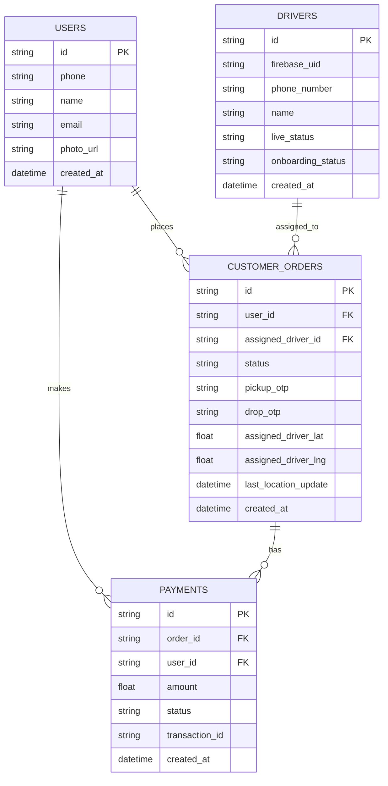
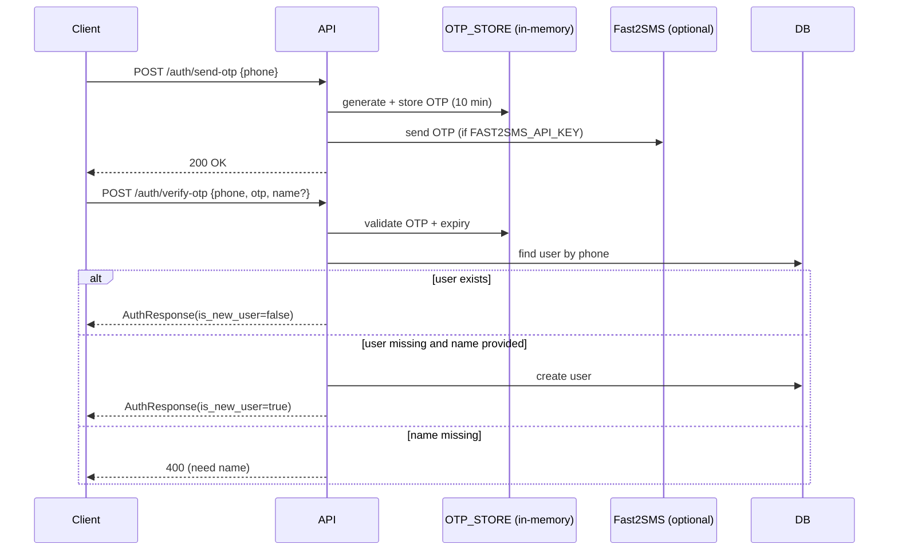
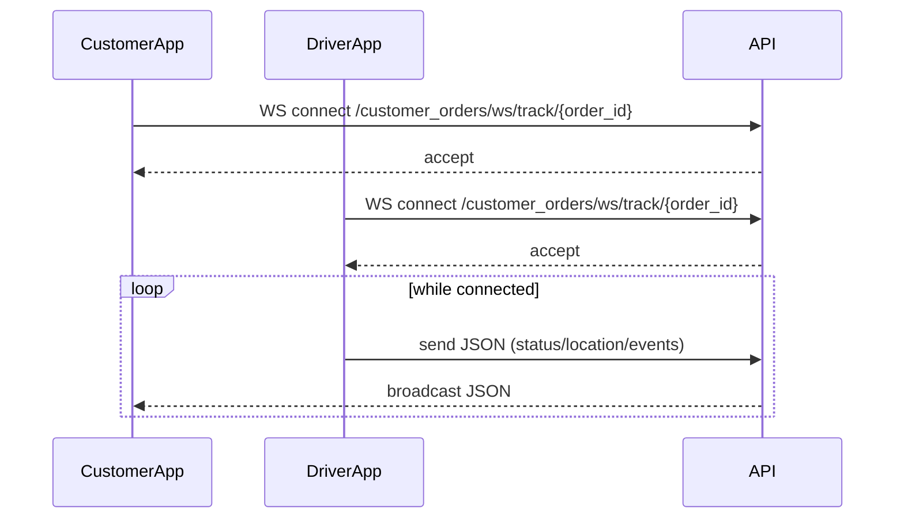
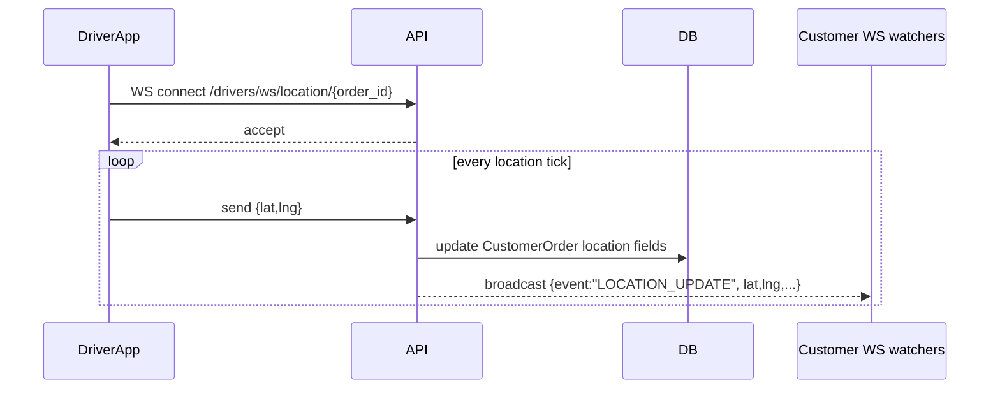
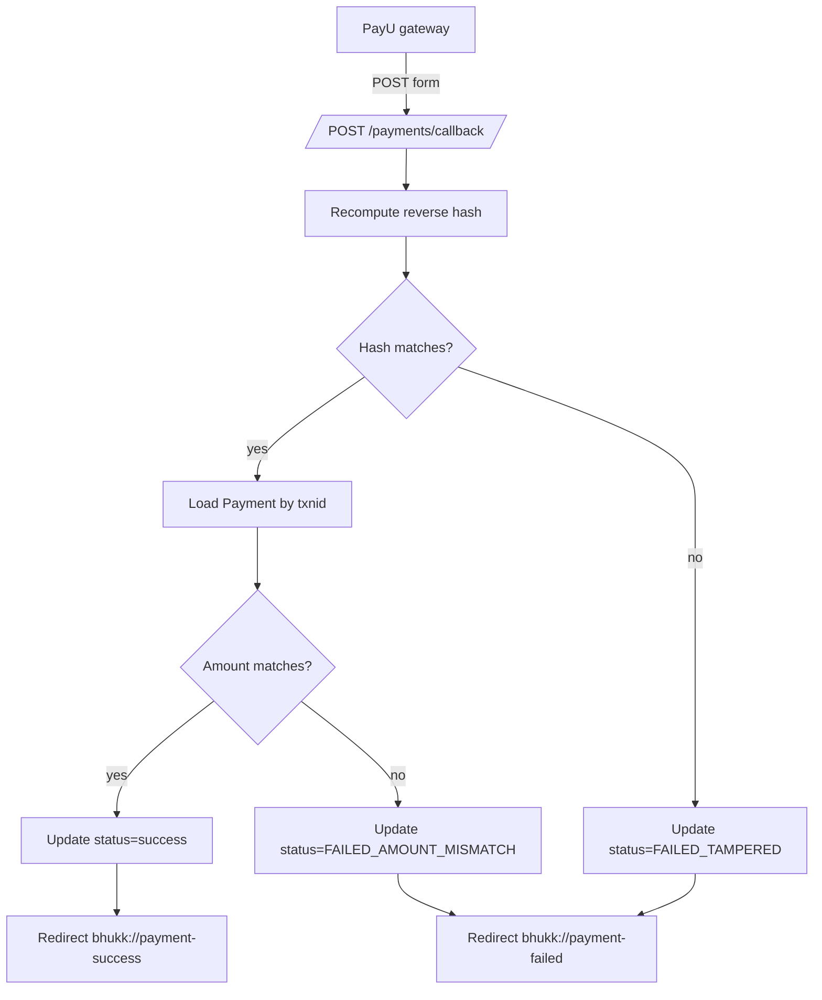
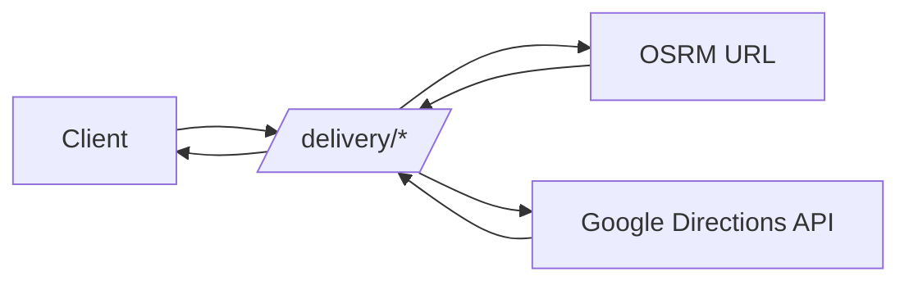

# Parcel Backend (FastAPI)

Backend service for a parcel/driver workflow with:

- REST APIs for users, customer orders, drivers, payments, delivery routing
- Real-time order tracking via WebSockets
- Postgres persistence via SQLAlchemy
- Schema migrations via Alembic
- Firebase token verification for driver-protected routes

---

## Repo layout

```
.
├─ main.py                  # FastAPI app + router registration
├─ database.py              # SQLAlchemy engine/session/Base + DB env validation
├─ db.py                    # Compatibility re-exports (Base/get_db/etc.)
├─ dependencies.py          # Firebase auth dependency
├─ routes/                  # API + WebSocket endpoints
├─ models/                  # SQLAlchemy ORM models
├─ schemas/                 # Pydantic request/response models
├─ crud/                    # DB helpers (create/update/list)
├─ utils/                   # External service helpers (routing)
├─ core/                    # File upload helpers
├─ alembic/                 # Alembic env + migrations
├─ Dockerfile               # Container build (runs migrations then starts server)
├─ docker-compose.yml       # Local orchestration (Postgres + backend + pgAdmin)
└─ requirements.txt         # Python dependencies
```

---

## High-level architecture

### Components

- **FastAPI app**: defined in `main.py`. Registers routers from `routes/*`.
- **Database**: Postgres via SQLAlchemy in `database.py`.
- **Migrations**: Alembic in `alembic/` (config in `alembic.ini`).
- **Auth**:
  - Driver-facing protected endpoints use Firebase ID tokens via `dependencies.verify_firebase_token`.
  - Customer/user OTP-based auth lives in `routes/auth.py` (Fast2SMS + an in-memory OTP store).
- **Real-time**: WebSocket endpoints in `routes/customer_orders.py` and `routes/drivers.py`.
- **External integrations**:
  - Routing: OSRM (`utils/routing.py`) and Google Directions (`routes/delivery.py`).
  - Payments: PayU hashing + callback (`routes/payments.py`).
  - SMS OTP: Fast2SMS (`routes/auth.py`).

### Request flow (HTTP)

```mermaid
flowchart LR
  Client[Mobile/Web Client]
  API[FastAPI: main.py]
  Router[routes/*]
  Dep[Depends(get_db)]
  DB[(Postgres)]
  CRUD[crud/*]

  Client -->|HTTP request| API
  API --> Router
  Router --> Dep
  Dep --> DB
  Router --> CRUD
  CRUD --> DB
  DB --> CRUD
  CRUD --> Router
  Router -->|HTTP response| Client
```

---

## Runtime constraints (read this first)

These are important “gotchas” for future devs.

1. **DB env vars are mandatory**
   - `database.py` and `alembic/env.py` raise at import time if `DB_HOST`, `DB_PORT`, `DB_USER`, `DB_PASSWORD`, `DB_NAME` are missing.

2. **`main.py` creates tables on startup**
   - `main.py` runs `Base.metadata.create_all(bind=engine)` on app startup.
  **Safety controls**:
    - `core/security_logic.py` (`PlatformGuard`) enforces cancellation limits and driver suspensions using Redis.
    - Ban checks are enforced in driver job discovery and acceptance.

3. **WebSocket state is in-memory**
   - `ParcelTrackingManager.active_rooms` is a Python dict in `routes/customer_orders.py`.
   - If you run multiple Uvicorn workers/replicas, clients connected to different processes will not see each other’s broadcasts.
   - For horizontal scaling, move WS fan-out to Redis pub/sub (or similar).

4. **OTP store is in-memory**
   - `routes/auth.py` uses `OTP_STORE` dict.
   - If the server restarts, all OTPs are lost.
   - With multiple replicas, OTP verification may fail if request hits a different instance.

5. **Uploads are written to local disk; no static serving in code**
   - Uploads are saved under `UPLOADS_DIR` (default `uploads/`) by `core/uploads.py`.
   - The API returns URL-like paths such as `/uploads/drivers/...`, but **this repo does not mount static file serving** (no `StaticFiles` mount found).
   - You must serve `uploads/` via a reverse proxy (nginx) or add `app.mount("/uploads", StaticFiles(...))`.

6. **CORS is fully open**
   - `main.py` allows `allow_origins=["*"]`, `allow_methods=["*"]`, `allow_headers=["*"]`.

---

## Environment variables

  7. **Redis is required for suspension logic**
     - `core/security_logic.py` connects to Redis at `localhost:6379` (hardcoded).
     - Cancellation limits and bans depend on Redis keys like `ban:driver:<id>` and `cancellations:driver:<id>`.
### Required (DB)

These must exist for both app startup and Alembic migrations:

- `DB_HOST`
- `DB_PORT`
- `DB_USER`
- `DB_PASSWORD`
- `DB_NAME`

### Optional (integrations / behavior)

- Firebase auth
  - `GOOGLE_APPLICATION_CREDENTIALS` (path to Firebase service account JSON)
  - `FIREBASE_AUTH_DISABLED=1` (dev-only escape hatch: skips real verification)
  - `AUTH_DEBUG=1` (more verbose auth error details)
  | `redis` | Redis client | `core/security_logic.py` (suspensions + cancellation windows) |

- SMS OTP
  - `FAST2SMS_API_KEY` (if missing, OTP is printed to console)
  - `POST /customer_orders/{order_id}/cancel`
    - Normalizes `user_id` (Firebase UID vs DB UUID for drivers)
    - Enforces ban checks via `PlatformGuard`
    - Driver cancellations free the order first, then apply suspension checks
  - `OSRM_URL` (default `http://router.project-osrm.org`)
  - `OSRM_BASE_FARE` (default `30.0`)
  - `OSRM_PER_KM` (default `15.0`)
  - `GOOGLE_MAPS_API_KEY` (required for `/delivery/get-directions`)

- Webhooks
  - `DRIVER_HUB_SECRET` (shared secret for `/webhooks/driver-assigned`)

- Uploads
  - `UPLOADS_DIR` (default `uploads`)

---

## Dependencies (requirements.txt)

| Library | Why it exists here | Primary usage |
|---|---|---|
| `fastapi` | Web framework (REST + WebSockets) | `main.py`, `routes/*` |
| `uvicorn[standard]` | ASGI server | Docker CMD, local dev |
| `sqlalchemy` | ORM + DB sessions | `database.py`, `models/*`, `crud/*` |
| `psycopg2-binary` | Postgres driver | SQLAlchemy engine |
| `alembic` | Migrations | `alembic/`, `alembic.ini` |
| `python-dotenv` | Load `.env` in dev | `main.py`, `database.py`, `alembic/env.py` |
| `pydantic` | Request/response validation | `schemas/*` |
| `requests` | Sync HTTP client | `routes/auth.py` (Fast2SMS) |
| `httpx` | Async HTTP client | `routes/delivery.py`, `utils/routing.py` |
| `firebase-admin` | Verify Firebase ID tokens | `dependencies.py` |
| `python-multipart` | Form/file upload parsing | `routes/drivers.py`, PayU callback form parsing |

---

## Database & models

### ORM models

- `models/user.py`
  - `User` has many `CustomerOrder` and many `Payment`
- `models/driver.py`
  - `Driver` has many assigned `CustomerOrder`
- `models/customer_order.py`
  - `CustomerOrder` references `User` and (optionally) a `Driver`
  - Stores OTPs (`pickup_otp`, `drop_otp`) and last-known driver coordinates
- `models/payment.py`
  - `Payment` references `User` and `CustomerOrder`

### Relationship diagram



---

## Migrations (Alembic)

### How Alembic gets the DB URL

`alembic/env.py` builds:

- `postgresql://{DB_USER}:{DB_PASSWORD}@{DB_HOST}:{DB_PORT}/{DB_NAME}`

If any are missing, Alembic raises a `RuntimeError`.

### Common commands

Run locally (expects env vars, `.env` is loaded in dev):

```bash
alembic current
alembic history
alembic upgrade head
alembic downgrade -1
```

Repo helper:

```bash
./scripts/run_alembic.sh upgrade head
```

### Migration flow

```mermaid
flowchart TD
  Start[Start migration]
  Env[Load env (.env in dev)]
  BuildURL[Build SQLAlchemy URL from DB_*]
  Cfg[Set sqlalchemy.url in Alembic config]
  Run[Run migrations]

  Start --> Env --> BuildURL --> Cfg --> Run
```

---

## API surface (routes)

Routers are registered in `main.py`.

### Health

- `GET /` → returns a simple JSON "Backend started" message

### Users (`routes/users.py`)

- `POST /users/create`
- `GET /users/list`
- `GET /users/{user_id}`
- `PUT /users/{user_id}`
- `DELETE /users/{user_id}`

### Auth / OTP (`routes/auth.py`)

- `POST /auth/check-number` (checks if phone exists)
- `POST /auth/send-otp`
- `POST /auth/verify-otp` (logs in or registers)

OTP flow:



Cancellation guard flow:

```mermaid
flowchart TD
  Start[Cancel request] --> Load[Load order by id]
  Load --> Exists{Order exists?}
  Exists -- no --> NotFound[404 Not found]
  Exists -- yes --> Status{Picked up?}
  Status -- yes --> Block[403 Cannot cancel]
  Status -- no --> Normalize[Normalize user_id]
  Normalize --> BanCheck{Driver ban?}
  BanCheck -- yes --> Ban[403 Suspended]
  BanCheck -- no --> Free[Free order (driver) or cancel (customer)]
  Free --> Commit[Commit DB updates]
  Commit --> Limit[Check cancellation limit]
  Limit -- exceeded --> Suspended[403 Suspension / daily limit]
  Limit -- ok --> Done[200 Success]
```

### Customer orders (`routes/customer_orders.py`)

- `POST /customer_orders/create`
- `GET /customer_orders/list` (supports `status_filter`, `skip`, `limit`)
- `GET /customer_orders/{order_id}`
- `PUT /customer_orders/{order_id}`
- `DELETE /customer_orders/{order_id}`
- `POST /customer_orders/{order_id}/hub-webhook` (legacy/bridge webhook)

#### WebSocket: customer tracking

- `WS /customer_orders/ws/track/{order_id}`

The server acts as a relay:

- Driver app sends JSON frames to the socket
- Server broadcasts those frames to all other clients watching that order



### Drivers (`routes/drivers.py`)

Protected routes require `Authorization: Bearer <firebase_id_token>`.

- `POST /drivers/create`
- `GET /drivers/list`
- `GET /drivers/exists?phone_number=...`
- `GET /drivers/{driver_id}`
- `PATCH /drivers/{driver_id}` (owner-only)
- `DELETE /drivers/{driver_id}` (owner-only)

Uploads:

- `POST /drivers/{driver_id}/documents?doc_type=...` (multipart file upload)
  - `doc_type` is validated against an allowlist (profile_photo, driving_license, etc.)
  - Saves a random filename under `UPLOADS_DIR/drivers/<safe_name>_<uid>/...`

Jobs:

- `GET /drivers/jobs/available`
- `POST /drivers/jobs/{order_id}/accept`
- `PUT /drivers/jobs/{order_id}/status` (validates pickup/drop OTP on certain statuses)
- `POST /drivers/{driver_id}/ban` (manual suspension via Redis)
- `POST /drivers/{driver_id}/unsuspend` (clears ban + cancellation history)

#### WebSocket: driver location

- `WS /drivers/ws/location/{order_id}`

Behavior:

- Accepts JSON frames like `{ "lat": ..., "lng": ... }`
- Updates `CustomerOrder.assigned_driver_lat/lng/last_location_update` in DB
- Broadcasts `LOCATION_UPDATE` events to order watchers via `parcel_ws_manager`



### Payments (`routes/payments.py`)

- `POST /payments/generate-hash`
  - Computes PayU hash sequence using `PAYU_MERCHANT_KEY` + `PAYU_MERCHANT_SALT`
- `POST /payments/callback`
  - Receives form post from PayU
  - Verifies hash
  - Updates `Payment.status`
  - Redirects to a custom scheme URL `bhukk://payment-success` or `bhukk://payment-failed`

CRUD:

- `POST /payments/create`
- `GET /payments/list`
- `GET /payments/{payment_id}`
- `PUT /payments/{payment_id}`

Payment callback flow:



### Delivery (`routes/delivery.py`)

- `POST /delivery/get-route`
  - Uses OSRM (via `utils/routing.calculate_osrm_route`) to return encoded polyline, distance, ETA, calculated fee
- `GET /delivery/get-directions`
  - Uses Google Directions API (requires `GOOGLE_MAPS_API_KEY`)

Routing flow:



### Webhooks (`routes/webhooks.py`)

- `POST /webhooks/driver-assigned`
  - Requires header `x-hub-secret`
  - Compares to `DRIVER_HUB_SECRET` (default `YOUR_LOCAL_SECRET_FOR_TESTING`)
  - Updates driver assignment fields on `CustomerOrder`

---

## WebSockets: operational notes

### Connection rooms

- Rooms are keyed by `order_id`.
- Each room contains a list of active `WebSocket` objects.

### Failure modes

- If a client disconnects unexpectedly, broadcast attempts may throw; the manager removes that socket.
- If you deploy behind a load balancer, ensure WebSocket upgrade headers are supported.

---

## Docker

### Dockerfile behavior

The container entrypoint:

1. Runs `alembic upgrade head`
2. Starts Uvicorn on port `8019`

See `Dockerfile`.

### Compose

`docker-compose.yml` starts:

- Postgres 15 (`db`)
- pgAdmin (`pgadmin`, exposed on `8018`)
- backend (`backend`, exposed on `8019`)

---

## Development tips

- If routing endpoints fail:
  - Check `OSRM_URL` and/or `GOOGLE_MAPS_API_KEY`
- If driver-protected endpoints fail with 401/500:
  - Ensure Firebase credentials (`GOOGLE_APPLICATION_CREDENTIALS`) are configured
  - Or (dev only) set `FIREBASE_AUTH_DISABLED=1`
- If uploads URLs 404:
  - This repo does not serve `/uploads/*` by default; add static hosting or a proxy rule

---

## Security notes

- Do not commit real service credentials.
  - This repo contains `service-account.json` in the root. Treat it as sensitive.
- Prefer tightening CORS for production.
- OTP and WS memory stores are dev-friendly but not production-grade without shared state.
